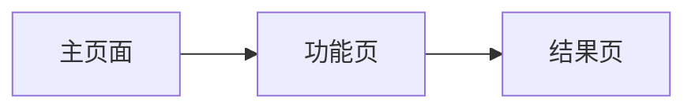

# UX 设计 — 实现二段跳与受控状态管理

> 所属需求：平台跳跃可玩原型：主角二段跳 + 冲刺

## 交互流程图

## 组件线框说明

## 实现二段跳与受控状态管理
- 主内容区
- 操作区（按钮/表单）
- 反馈区（Toast/弹窗）

## 交互状态定义

- 按钮：正常 / hover / loading / disabled
- 列表：正常 / 加载中 / 空状态 / 错误

## 响应式/适配规则

移动端优先，flex 布局

## UI 资产清单（初稿）

- icon: 待补充
- illustration: 空状态图（400x300）
