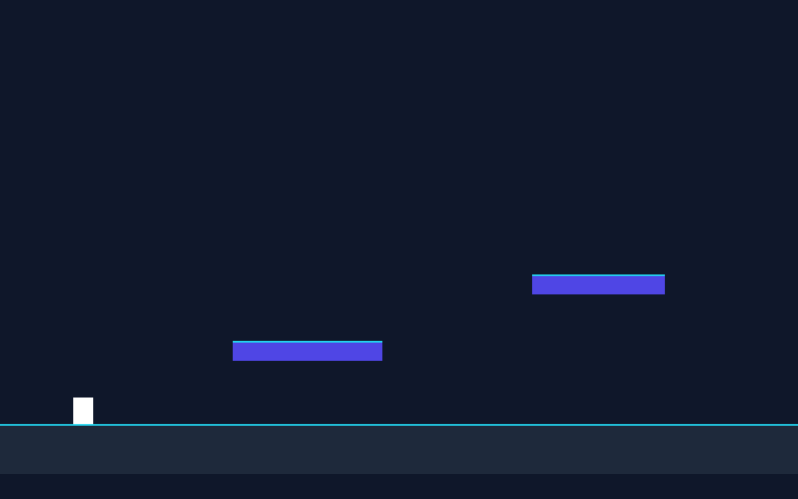

# 产品验收 — 实现二段跳与受控状态管理

## 结果: ✅ 通过

| 项目 | 值 |
|------|------|
| 评分 | 8/10 (通过线: 6) |
| 状态 | acceptance_passed |

## 反馈
二段跳与受控状态管理核心功能已实现。PlayerState.ts 通过纯函数 reducer + PlayerAction（JUMP/LAND/RESET）实现受控跳跃次数更新，jumpCount 只能通过 dispatch(action) 修改，起跳消耗一次、落地（LAND）重置、默认 maxJumps=2，完全符合需求描述。constants.ts 定义 maxJumps=2、jumpVelocity、doubleJumpVelocity 与 PlayerState 枚举。Player.ts 实现 jumpsUsed 计数、触地重置与最大跳跃次数限制。h5_typecheck（tsc 零错误）与 h5_playtest（Vite 生产打包 + Playwright Canvas 挂载零运行时错误）均通过，页面可正常打开渲染。

## 检查清单
  1. 页面能否正常打开
  2. 功能是否符合需求描述
  3. 界面是否美观合理
  4. TypeScript 编译与 Vite 生产打包是否通过
  5. Phaser Canvas 画布是否在浏览器中成功挂载且无运行时 console.error / pageerror
  6. 核心源码（Scene / Level / 实体逻辑）是否完整实现了工单要求的功能点

## 运行效果截图

## 问题
- gameConfig.ts 中 physics.arcade.gravity 仍为 { x: 0, y: 0 }，且注释 'No gravity yet... the jump ticket will set it' 与本次跳跃工单不符，需确认 GameScene 是否在别处覆盖设置了重力（constants.ts 已定义 PHYSICS.gravityY=1200）。若重力确为 0，角色起跳后将无法自然下落，影响落地重置（LAND）的实际触发。
