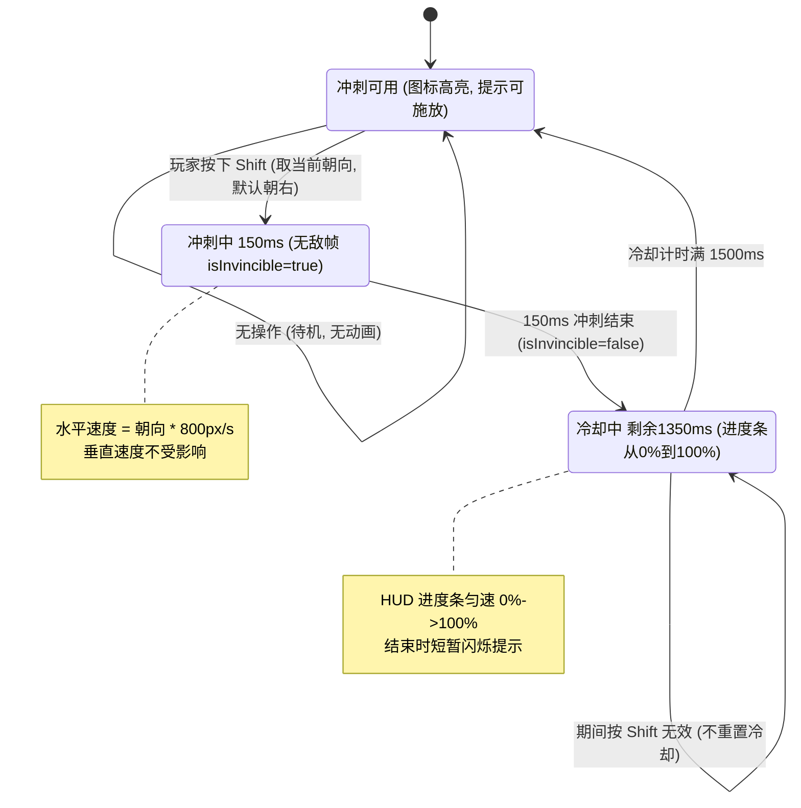
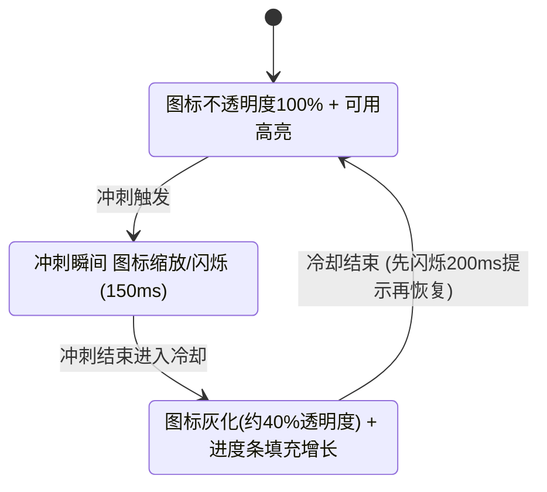

# UX 设计 — 实现冲刺、无敌帧与冷却反馈

> 所属需求：平台跳跃可玩原型：主角二段跳 + 冲刺

## 交互流程图



补充 HUD 视觉状态流：

```

## 组件线框说明

## HUD 冲刺技能指示器 (Dash Skill Indicator)

位置：屏幕右下角，HUD 常驻层，不遮挡角色操作，z-index 高于场景低于暂停面板。

结构（自下而上三层叠加）：

1. **技能槽底板 (Skill Slot Base)**
   - 固定方形占位容器（约 64px），承载以下所有元素。
   - 职责：提供统一的对齐基准与点击热区（本工单无点击，仅视觉反馈）。

2. **冲刺技能图标 (Dash Icon)**
   - 中心放置，纯色矩形占位（当前无美术）。
   - 职责：表达"这是冲刺技能"，冷却期间整体灰化。

3. **冷却进度条 (Cooldown Progress Bar)**
   - 覆盖于图标上层的径向或垂直填充条，从 0% 填充到 100%。
   - 由 `dashCooldownRemaining` 反推进度：progress = 1 - remaining/1500。
   - 职责：冷却期间唯一动态数据来源，实时反映剩余时间。

4. **快捷键提示角标 (Key Hint Badge)**
   - 底板角落小标签，显示 "Shift"。
   - 职责：告知玩家触发方式；冷却期间可同步变暗。

5. **状态标签 (State Label，可选)**
   - 冷却期间显示剩余秒数（如 1.5s → 0.0s）。
   - 职责：提供精确数值反馈，增强可读性。

数据绑定说明（受控 action）：
- 组件仅订阅 store 派生状态，渲染逻辑不直接改 store。
- 可用性判定 `canDash = isDashing === false && dashCooldownRemaining <= 0`。
- 所有状态变更走 action：`startDash()` / `endDash()` / `tickDashCooldown(delta)`。

## 交互状态定义

## 冲刺技能指示器 (Dash Skill Indicator) 交互状态

| 状态 | 触发条件 | 视觉/交互表现 |
|------|---------|--------------|
| 默认/可用 (Available) | 冷却结束，canDash=true | 图标不透明度 100%，进度条隐藏，Shift 角标高亮；按 Shift 立即响应 |
| 按下/激活 (Active/Pressed) | 按下 Shift 且 canDash=true | 图标 0.95 scale + 短暂亮度变化（150ms），进度条瞬时归 0 |
| 禁用/冷却 (Disabled/Cooldown) | 冲刺结束进入冷却 | 图标不透明度约 0.4，Shift 角标变暗；进度条从 0% 匀速填充至 100%；期间按 Shift 不响应 |
| 冷却完成提示 (CooldownComplete) | 进度达 100% 瞬间 | 图标短暂闪烁（约 200ms 高亮脉冲）后回到可用态，作为"可再次施放"的即时反馈 |
| 加载中 (Loading) | 无（本组件无异步数据） | 不适用 |
| 空状态 (Empty) | 无（技能常驻） | 不适用 |
| 错误 (Error) | 无（本地状态，无网络/服务） | 不适用 |

## 冲刺动作期间的主角交互状态（关联说明）

| 状态 | 条件 | 表现 |
|------|------|------|
| 冲刺中 (Dashing) | isDashing=true | 水平速度 = 朝向 × 800px/s，持续 150ms |
| 无敌 (Invincible) | 冲刺开始 0~150ms | isInvincible=true，150ms 后恢复 false（本工单暂不接受伤判定） |
| 冷却 (Cooldown) | dashCooldownRemaining > 0 | 按 Shift 无效，不重置冷却 |

## 响应式/适配规则

## 响应式断点（HUD 冲刺指示器缩放）

| 断点 | 范围 | 冲刺指示器尺寸 | 说明 |
|------|------|--------------|------|
| Mobile | < 768px | 48px（底板），角标与标签缩放 0.75 | 紧凑布局，HUD 靠边内缩 12px，进度条更粗保证可视 |
| Tablet | 768–1024px | 56px | 默认比例，角标内缩 16px |
| Desktop | > 1024px | 64px | 完整尺寸，角标内缩 20px |

通用规则：
- 指示器锚定屏幕右下角，随视口等比缩放，不裁切进度条与角标。
- 冷却剩余秒数文字在 < 768px 时隐藏，仅保留进度条（避免占用空间）。
- 冲刺期间图标缩放动画（0.95）在各断点统一，保证操作反馈一致性。

## UI 资产清单（初稿）

- icon: dash-skill（冲刺技能图标，64px，实心/outline 风格，当前用纯色矩形占位）
- icon: shift-key-hint（Shift 快捷键角标，24px，outline 风格，提示触发按键）
- image: dash-cooldown-progress-bg（冷却进度条背景，64x64 或径向环形，纯色占位）
- image: dash-cooldown-progress-fill（冷却进度条填充层，64x64，纯色占位，随进度裁切/填充）
- icon: dash-ready-glow（可用态高亮描边/光晕，64px，outline 风格，可选）
- icon: dash-cooldown-lock（冷却态锁定角标，24px，outline 风格，可选，强调不可用）
