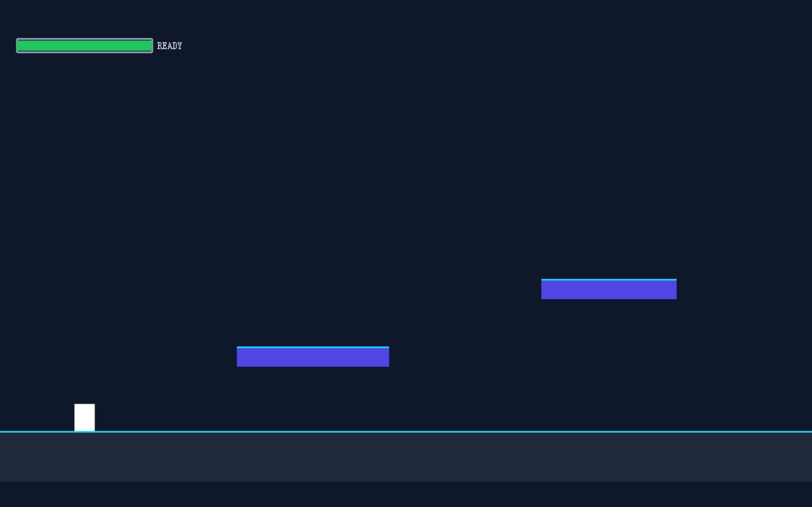

# 产品验收 — 实现冲刺、无敌帧与冷却反馈

## 结果: ✅ 通过

| 项目 | 值 |
|------|------|
| 评分 | 9/10 (通过线: 6) |
| 状态 | acceptance_passed |

## 反馈
需求达标。核心功能三点均已完整实现：1) Shift 冲刺——Player.ts 绑定 keyShift 触发冲刺，PlayerState 通过 DASH action 受控更新；2) 短无敌帧——DashCooldownBar.ts 与 PlayerState.ts 均独立跟踪 invincibleRemaining 并暴露 isInvincible()/isInvincible 查询，冲刺期间及冲刺后 buffer 时间处于无敌；3) 冷却与 UI 反馈——DashCooldownBar 提供填充条随冷却比例收缩、颜色切换（fillColor/readyColor）、倒计时秒数标签（READY 提示），Player 冷却期灰色染色。状态管理遵循项目规范（受控 action + 纯函数 reducer，无 any、不变性通过 dispatch 保证）。自动化证据显示 h5_typecheck（tsc 零错误）与 h5_playtest（Vite 打包 + Playwright 无头浏览器 Canvas 挂载零运行时报错）均通过，页面正常渲染。代码结构清晰、注释充分、事件清理（DESTROY 时 off UPDATE）到位。

## 检查清单
  1. 页面能否正常打开
  2. 功能是否符合需求描述
  3. 界面是否美观合理
  4. TypeScript 编译与 Vite 生产打包是否通过
  5. Phaser Canvas 画布是否在浏览器中成功挂载且无运行时 console.error / pageerror
  6. 核心源码（Scene / Level / 实体逻辑）是否完整实现了工单要求的功能点

## 运行效果截图

## 问题
无
