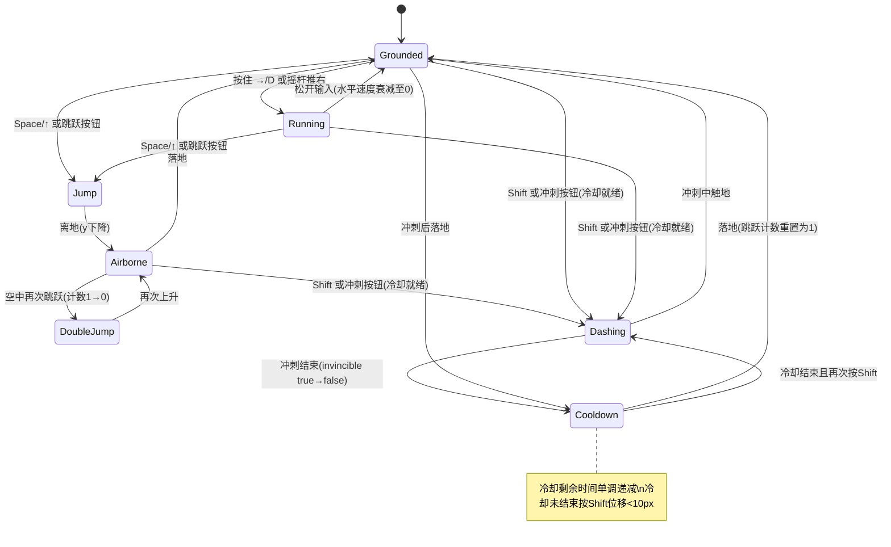

# UX 设计 — 可玩原型验收自测

> 所属需求：平台跳跃可玩原型：主角二段跳 + 冲刺

## 交互流程图

## 组件线框说明

根节点 #game-root 全屏 Canvas。\n\n【1. HUD 状态只读面板】(左上角, 测试期常显, 正式版可隐藏)\n- jump_remaining: 跳跃剩余次数(1/0)\n- dash_cooldown_ms: 冲刺冷却剩余毫秒(单调递减数字)\n- position_x / position_y: 角色坐标\n- is_grounded / is_invincible: 布尔状态\n- 说明: 该面板数据由 Phaser 注册到 window.__gameState 供 Playwright 读取断言, 不依赖肉眼。\n\n【2. 冲刺冷却指示条】(顶部居中, 游戏中常显)\n- 冷却条: 背景槽 + 填充条, 冷却中填充比例随 dash_cooldown_ms 收缩\n- 就绪态: 填充满 + 高亮提示可冲刺\n\n【3. 触控控制层】(移动端/触控视口显示, 桌面隐藏)\n- 左区: 虚拟摇杆 (虚拟摇杆底座 + 摇杆头, 触摸拖动控制方向)\n- 右区: 跳跃按钮 + 冲刺按钮 (并排竖排)\n- 说明: 桌面端显示键盘提示 (→/D 移动, Space 跳跃, Shift 冲刺)。\n\n【4. 截图归档目录结构】(脚本产物, 非游戏内 UI)\n- screenshots/<timestamp>/01_initial.png\n- 02_move_right.png / 03_jump.png / 04_double_jump.png / 05_dash.png / 06_cooldown.png\n- failures/<timestamp>/<assertion_name>_actual.png (失败截图)

## 交互状态定义

【虚拟摇杆】\n- normal: 底座与摇杆头静止于中心\n- active: 摇杆头随触摸点偏移, 输出方向向量\n- disabled: 桌面键盘模式下隐藏\n- (无 loading/empty/error 态)\n\n【跳跃按钮】\n- normal: 可点击\n- active: 按下 scale 0.95 + 亮度变化, 触发跳跃/二段跳\n- disabled: 已用尽二段跳时视觉置灰, 落地恢复\n- (无 loading/empty/error 态)\n\n【冲刺按钮】\n- normal: 冷却就绪可点击\n- active: 按下 scale 0.95, 触发冲刺\n- disabled: 冷却中 opacity 0.45 + cursor not-allowed, 点击不触发位移\n- loading: 冷却进行中, 按钮旁/内部显示冷却条收缩\n- (无 empty/error 态)\n\n【冷却指示条】\n- normal: 就绪, 满条高亮\n- active: 冲刺刚触发, 立即开始收缩\n- disabled: 冷却中, 填充条随剩余毫秒单调收缩\n- empty: 剩余为 0, 满条恢复就绪\n\n【HUD 状态面板】\n- normal: 实时刷新数值\n- empty: 场景未就绪前显示 '-' 占位\n- error: 读取 window.__gameState 失败时显示 'N/A'

## 响应式/适配规则

断点: mobile < 768px / tablet 768-1024px / desktop > 1024px\n\nmobile(<768): 显示触控控制层(虚拟摇杆+跳跃+冲刺按钮); HUD 面板缩放 0.8; 冷却条宽度 60vw; 隐藏键盘提示。\ntablet(768-1024): 默认显示触控层(可被桌面模式覆盖); HUD 面板缩放 0.9; 冷却条宽度 40vw。\ndesktop(>1024): 隐藏触控控制层; 显示键盘提示文案; HUD 面板原尺寸; 冷却条固定像素宽。\n\n输入模式切换: 通过 Playwright 模拟 touch 事件或检测 touch 设备时强制启用触控层; 桌面 Chromium 默认键盘模式。

## UI 资产清单（初稿）

- icon: jump（跳跃按钮图标, 48px, outline 风格, 上箭头）\n- icon: dash（冲刺按钮图标, 48px, outline 风格, 右向双箭头/闪电）\n- icon: joystick_base（虚拟摇杆底座, 120px, 圆形描边）\n- icon: joystick_knob（虚拟摇杆头, 56px, 实心圆形）\n- icon: key_arrow（键盘提示 →, 24px, outline 风格）\n- icon: key_space（键盘提示空格键, 48px, outline 风格键帽）\n- icon: key_shift（键盘提示 Shift, 48px, outline 风格键帽）\n- illustration: empty_hud（HUD 未就绪占位, 200x40, 灰色横条）\n- image: cooldown_bar_fill（冷却条填充, 1x12 可拉伸平铺像素）\n- 说明: 角色/平台/地面使用矩形占位绘制, 不引入美术资源
