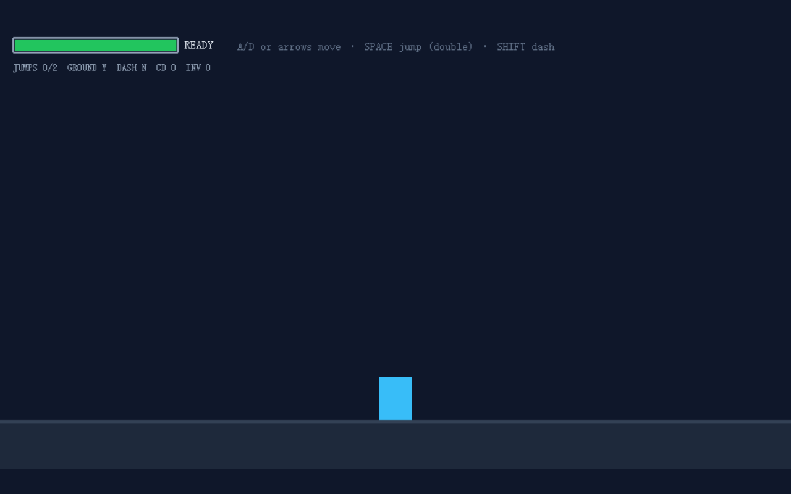

# 开发笔记 — 可玩原型验收自测

> 2026-10-24 12:55 | LLM

## 产出文件
- [src/acceptance/acceptanceProbe.ts](/app#repo?file=src/acceptance/acceptanceProbe.ts) (20011 chars)

## 自测: 自测 7/7 通过 ✅

| 检查项 | 结果 | 说明 |
|--------|------|------|
| 文件产出 | ✅ | 1 个文件 |
| 入口文件 | ✅ | 存在 |
| 代码非空 | ✅ | 通过 |
| 语法检查 | ✅ | 通过 |
| 文件名规范 | ✅ | 全英文 |
| 磁盘落地 | ✅ | 1 个文件已落盘 |
| 页面截图 | ✅ | 1 张截图 |

## 代码变更 (Diff)

### src/acceptance/acceptanceProbe.ts (修改)
```diff
--- a/src/acceptance/acceptanceProbe.ts
+++ b/src/acceptance/acceptanceProbe.ts
@@ -25,8 +25,8 @@
  */

 

 import { chromium, type Browser, type Page } from 'playwright';

+import { PNG } from 'pngjs';

 import { existsSync, mkdirSync, readFileSync, writeFileSync } from 'node:fs';

-import { createRequire } from 'node:module';

 import { dirname, join, resolve } from 'node:path';

 import { fileURLToPath } from 'node:url';

 

@@ -38,13 +38,6 @@
   TOUCH_QUERY_PARAM,

 } from '../constants';

 import { getLevelSummary, type LevelSummary } from '../level/levelLayout';

-

-// pngjs 是 playwright 的 Node-only 传递依赖，主项目（浏览器）tsc 编译面无法解析其类型；

-// 改为运行时 require 并以内联最小结构声明返回类型，规避 TS2307 且不影响像素比对逻辑。

-const require = createRequire(import.meta.url);

-const PNG = require('pngjs') as {

-  sync: { read(buffer: Buffer): { width: number; height: number; data: Buffer } };

-};

 

 // ---------------------------------------------------------------------------

 // 运行时钩子类型（与 index.html / main.ts 的 window.__game、BootScene 的

@@ -158,13 +151,15 @@
     return 1;

   }

   const total = a.width * a.height;

+  const da = a.data;

+  const db = b.data;

   let changed = 0;

   for (let i = 0; i < total; i++) {

     const o = i * 4;

-    const dr = Math.abs(a.data[o] - b.data[o]);

-    const dg = Math.abs(a.data[o + 1] - b.data[o + 1]);

-    const db = Math.abs(a.data[o + 2] - b.data[o + 2]);

-    if (dr + dg + db > 48) {

+    const dr = Math.abs(da.readUInt8(o) - db.readUInt8(o));

+    const dg = Math.abs(da.readUInt8(o + 1) - db.readUInt8(o + 1));

+    const dbDiff = Math.abs(da.readUInt8(o + 2) - db.readUInt8(o + 2));

+    if (dr + dg + dbDiff > 48) {

       changed++;

     }

   }

@@ -479,6 +474,169 @@
         detail: `showTouch=${showTouch} domVisible=${ui.domVisible} fallbackActive=${ui.fallbackActive}`,

       });

 

... (共 219 行变更)
```

## 页面预览截图



