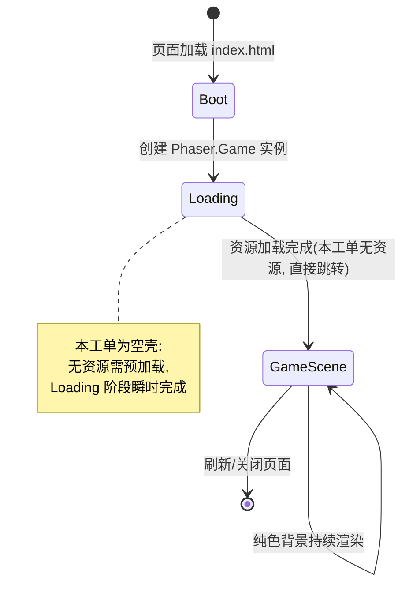

# UX 设计 — 初始化 Vite + Phaser 3 + TypeScript 脚手架

> 所属需求：平台跳跃可玩原型：主角二段跳 + 冲刺

## 交互流程图



页面级流程说明:
1. 浏览器请求 index.html → 挂载 #game-container 节点
2. src/main.ts 执行: 创建 Phaser.Game + 注册 GameScene + 启动
3. canvas 渲染纯色背景, 进入稳定空壳状态
4. 窗口 resize → Phaser Scale Manager 自适应重排, canvas 无白屏
5. dev / preview 两种环境渲染结果一致
```

## 组件线框说明

单页面、单场景结构, 无多页面跳转。

```
┌─────────────────────────────────────────────┐
│ index.html                                  │
│  └── #game-container (canvas 挂载点, 100vw×100vh)│
│       └── <canvas> (Phaser.Game 自动创建)      │
│            └── GameScene                       │
│                 ├── 纯色背景 (Phaser 内置矩形填充)│
│                 └── [HUD 占位层] (本工单不实现,   │
│                      仅预留 create() 扩展点)     │
└─────────────────────────────────────────────┘
```

主要区域:
- 根挂载点: #game-container, 占据整个视口
- 游戏画布: 由 Phaser 自动注入, 尺寸受 Scale Manager 控制
- 场景层: 单一 GameScene, 仅做背景色渲染 + 生命周期钩子占位

预留(本工单不实现, 供后续玩法工单挂载):
- HUD 层 (分数/生命/按键提示)
- 弹窗层 (暂停/结算面板)
- 主角精灵占位 (后续二段跳/冲刺工单)

## 交互状态定义

本工单为空壳脚手架, 无业务可交互组件, 仅覆盖画布容器的系统级状态:

【游戏画布 canvas】
- 正常: 渲染纯色背景, 无报错
- 加载中(Loading): 从页面打开到 canvas 首次绘制之间 (要求 ≤ 5s)
- 空状态(empty): 本工单无玩法内容, 空壳即为预期终态, 不展示额外引导
- 错误(error): 控制台报错/白屏 → 需在 main.ts 边界捕获并输出可见错误提示 (开发期保障)

【窗口缩放 (非组件, 但为系统交互)】
- resize: canvas 自适应缩放, 保持 FIT/CENTER_BOTH 策略, 不裁剪不拉伸
- 刷新: 场景重载, 恢复纯色背景

预留交互组件 (后续玩法工单实现, 本工单仅列出状态清单):
- 按钮: normal / hover / active / disabled / loading / success
- 开关(Toggle): on / off / 过渡动画 / disabled
- 列表项/卡片: normal / hover / selected / loading / empty

说明: 因 PRD 明确「不含玩法逻辑」, 本工单不产生任何可交互按钮/输入框, 上表交互状态仅用于指导后续 HUD/弹窗工单, 不在本工单验收范围内。

## 响应式/适配规则

Phaser Scale Manager 统一处理跨端缩放, 断点策略如下:

- mobile (< 768px): Scale.FIT + autoCenter CENTER_BOTH, 保持游戏设计分辨率等比例缩放, 留黑边; 本工单暂不实现触控, 仅保证 canvas 正常渲染
- tablet (768-1024px): 同 FIT 策略, 画布居中
- desktop (> 1024px): 同 FIT 策略, 画布居中; 后续玩法可扩展 RESIZE 策略做自适应布局

实现约定 (本工单落地):
- 使用 Phaser.Scale.FIT + CENTER_BOTH, 保证任意视口下画布完整可见、不变形
- 推荐设计基准分辨率: 960×540 (16:9), 后续玩法可直接复用
- 禁止 CSS 硬编码 canvas 宽高, 统一由 Scale Manager 接管
- 刷新/缩放后无白屏, 与 PRD 验收标准对齐

## UI 资产清单（初稿）

本工单为空壳脚手架, 背景使用 Phaser 内置纯色填充 (无图片资源), 故无需引入图标/插画/图片。

当前资产清单: 无 (empty)

后续玩法工单预留 (本工单不交付, 仅登记线索):
- icon: jump-button (二段跳按键提示, 48px, outline 风格)
- icon: dash-button (冲刺按键提示, 48px, outline 风格)
- icon: pause (暂停按钮, 24px, outline 风格)
- illustration: empty-level (关卡无内容占位, 400×300)
- image: player-spritesheet (主角待机/跑动/跳跃帧序列图, 供后续动画工单)

说明: 上述资产均不属于本工单范围, 依据 PRD「不包含美术资源」边界条件, 本工单 UI 资产交付量为 0。
