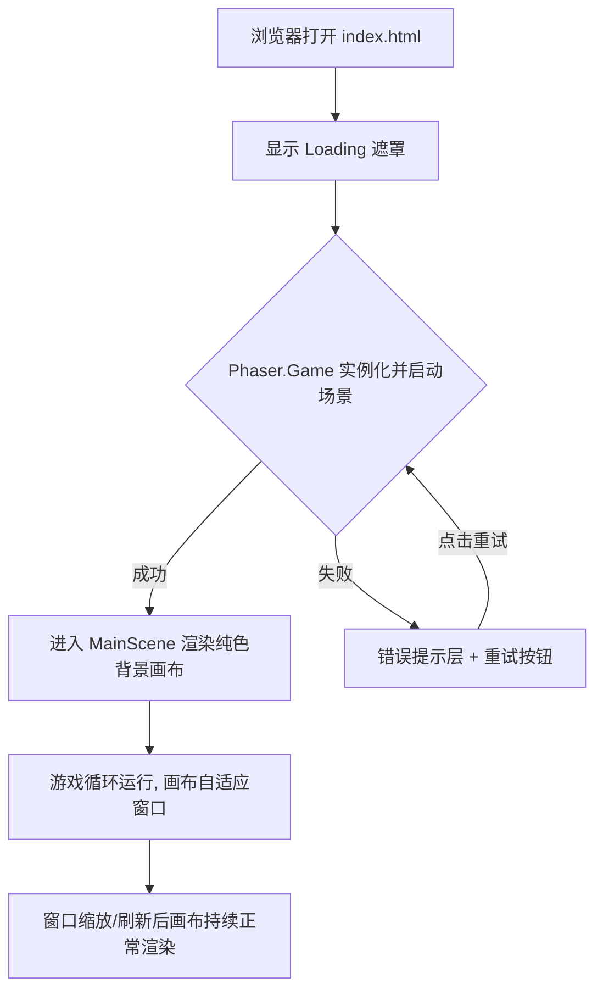

# UX 设计 — 初始化 Vite + Phaser 3 + TypeScript 脚手架

> 所属需求：平台跳跃可玩原型：主角二段跳 + 冲刺

## 交互流程图

## 组件线框说明

页面结构自上而下:
1. #app 根容器: 全屏, position:relative, overflow:hidden
2. Canvas 挂载节点: Phaser 自动创建 canvas, 占满容器, 居中
3. Loading 遮罩层: 启动加载态, 含 loading-spinner + 「加载中」文案, 加载完成 fade out
4. 错误提示层: 加载失败时显示, 含错误文案 + 重试按钮
5. 预留 HUD 层: 后续玩法工单实现, 本工单不实现

## 交互状态定义

本工单为脚手架空壳, 可交互组件极少, 当前包含:
- Loading 遮罩: loading(显示 spinner + 加载中文案) / success(加载完成, 200ms fade out) / error(加载失败切换为错误提示)
- 重试按钮(仅加载失败时出现): normal / hover(亮度变化) / active(scale 0.95) / loading(点击后回到加载态并禁用防重复点击) / disabled
- 游戏画布 canvas: 正常渲染纯色背景 / 窗口缩放自适应 / 刷新后重新初始化无残留

## 响应式/适配规则

断点: mobile <768px / tablet 768-1024px / desktop >1024px
- 画布自适应: Phaser Scale 使用 FIT 模式(保持比例留边)或 RESIZE 模式(拉伸重排, 后续玩法推荐)
- mobile: 优先触摸, 画布全屏铺满, 禁用浏览器默认滚动
- tablet/desktop: 画布居中, 等比缩放, 保持纵横比
- 所有断点下禁止出现滚动条与白屏

## UI 资产清单（初稿）

本工单(脚手架)暂无玩法美术资产, 仅需:
- icon: loading-spinner(启动加载指示, 24px, outline 风格)
- icon: refresh(加载失败重试按钮, 24px, outline 风格)
- 后续玩法工单预留: HUD 图标(跳跃/冲刺能量条等)待补充
