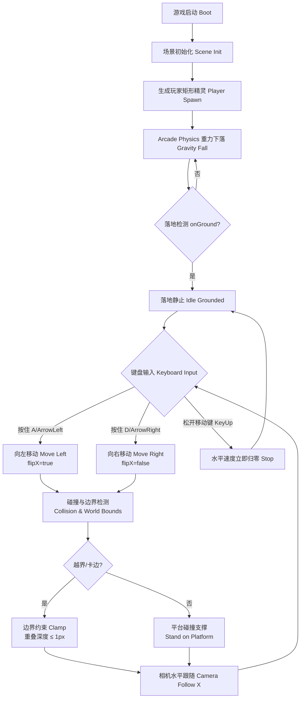
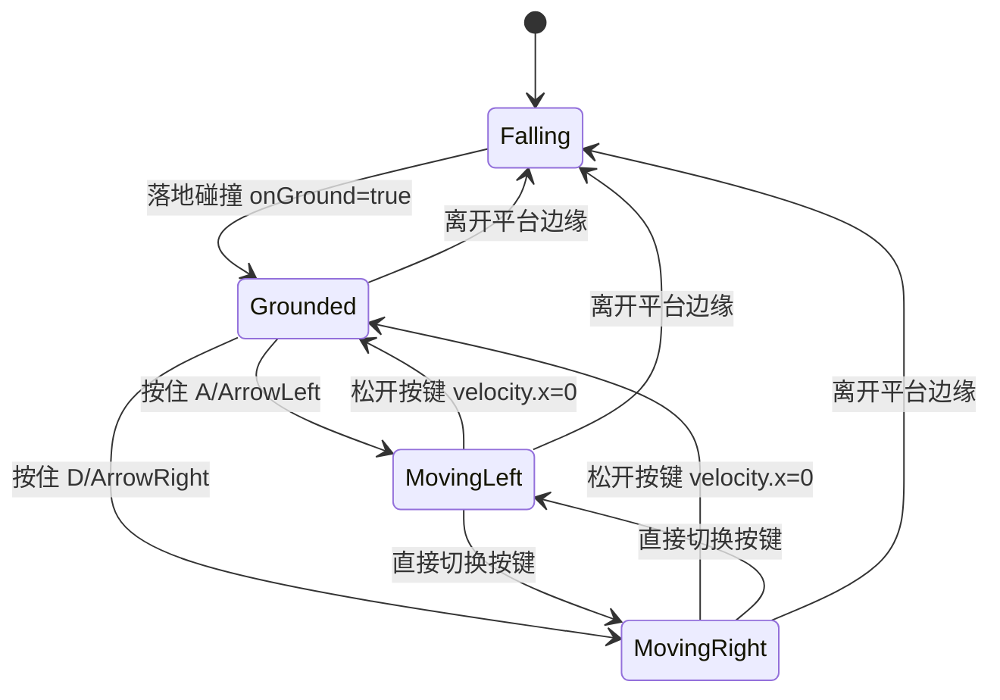

# UX 设计 — 实现玩家移动与重力物理

> 所属需求：平台跳跃可玩原型：主角二段跳 + 冲刺

## 交互流程图




```

## 组件线框说明

游戏场景 GameScene（单屏横版，无页面跳转，仅 HUD 覆盖层）

【场景层 Scene】
- 世界边界 World Bounds：约束玩家水平移动范围（左右 clamp）
- 主相机 Main Camera：水平方向 startFollow + lerp 平滑，垂直方向锁定初始 Y

【平台层 Platforms】
- 地面 Ground：1 块矩形静态碰撞体（immovable），位于场景底部
- 平台 Platform ×3+：矩形静态碰撞体（immovable），错落分布，玩家可从上站立、下/侧碰撞不穿透

【玩家层 Player】
- 玩家精灵 Player Sprite：纯色矩形占位，接入 Arcade Physics 重力
  - 初始位置：固定在地面正上方，加载后自然下落
  - 朝向状态：flipX（左=true / 右=false），1 帧内生效

【HUD 覆盖层 HUD Overlay（占位）】
- 调试信息面板 Debug Panel（可选，原型阶段）：显示水平速度 velocity.x、是否落地 onGround、朝向 flipX，仅开发调试用，正式 UI 后续工单接入

【输入层 Input】
- 键盘监听：A/ArrowLeft（左移）、D/ArrowRight（右移），keydown 持续生效 / keyup 立即归零

【状态层 State（受控 action）】
- 统一由 service/action 更新：moveLeft()、moveRight()、stop()、setOnGround()、setFacing()，禁止直接改 body/velocity 属性

## 交互状态定义

【键盘输入（← → / A D）】
- 正常 idle：未按下，水平速度 0，玩家静止贴地
- 按下按下 active：keydown 持续，水平速度稳定 160~200 px/s，100ms 内生效
- 切换切换切换 switch：左/右按键直接互切，朝向与 flipX 1 帧内更新
- 松开松开松开 released：keyup，100ms 内水平速度归零
- 无禁用/加载/空/错误态（键盘输入为持续物理输入）

【玩家精灵 Player Sprite】
- idle 静止：落地静止，不抖动、不穿透地面
- moving-left：flipX=true，向左平移
- moving-right：flipX=false，向右平移
- falling：离地受重力下落（本工单不接跳跃，仅从平台边缘自然下落）
- grounded：贴地/贴平台，onGround=true，持续按住移动键保持贴地不悬空不陷入
- boundary-clamp：触及左右边界，重叠深度 ≤ 1px，不越界不卡死

【相机 Main Camera】
- follow-x：水平跟随，玩家恒定位于画面左 1/3（误差 ±10% 屏宽）
- follow-y-lock：垂直保持初始 Y 不变
- lerp：可选平滑跟随，无硬切

【地面/平台 Ground & Platforms】
- 默认 normal：静态 immovable 碰撞体
- 碰撞 collision：从上支撑玩家、从下/侧阻挡不穿透

【HUD 调试面板 Debug Panel（占位）】
- normal：显示实时调试数值（velocity.x / onGround / flipX）
- 无 hover/active/disabled/loading/empty/error（纯只读调试信息）

## 响应式/适配规则

断点：mobile < 768px / tablet 768-1024px / desktop > 1024px

- desktop（>1024px）：完整横版视野，键盘 ← → / A D 输入为主，相机左 1/3 跟随
- tablet（768-1024px）：同 desktop 布局缩放，键盘输入为主；触控不支持（原型阶段）
- mobile（<768px）：暂不支持触控/虚拟摇杆（PRD 边界条件明确排除），仅保证不崩溃、显示完整场景缩放

通用规则：
- 游戏画布按比例缩放，保持 16:9 或适配屏幕宽高比，不裁剪世界边界
- HUD 调试面板锚定屏幕角落（左上/右上），不随相机移动
- 玩家左 1/3 跟随偏移在不同断点按屏宽百分比换算，不写死像素

## UI 资产清单（初稿）

- image: player-sprite（玩家矩形占位，纯色，尺寸建议 32x32 或 48x48 px，可复用为后续二段跳/冲刺主角）
- image: ground-platform（地面矩形占位，纯色，宽度覆盖场景底部）
- image: platform-static（静态平台矩形占位，纯色，≥3 块，尺寸错落如 128x16 / 192x16 px）
- icon: debug-velocity（调试面板速度值图标，16px，outline 风格，占位可选）
- icon: debug-onground（调试面板落地状态图标，16px，outline 风格，占位可选）
- icon: debug-facing（调试面板朝向图标，16px，outline 风格，占位可选）
- 说明：本工单为物理与移动原型，无外部图片/音效/动画资产需求，全部使用 Phaser Rectangle 纯色占位，正式美术资源由后续工单替换
